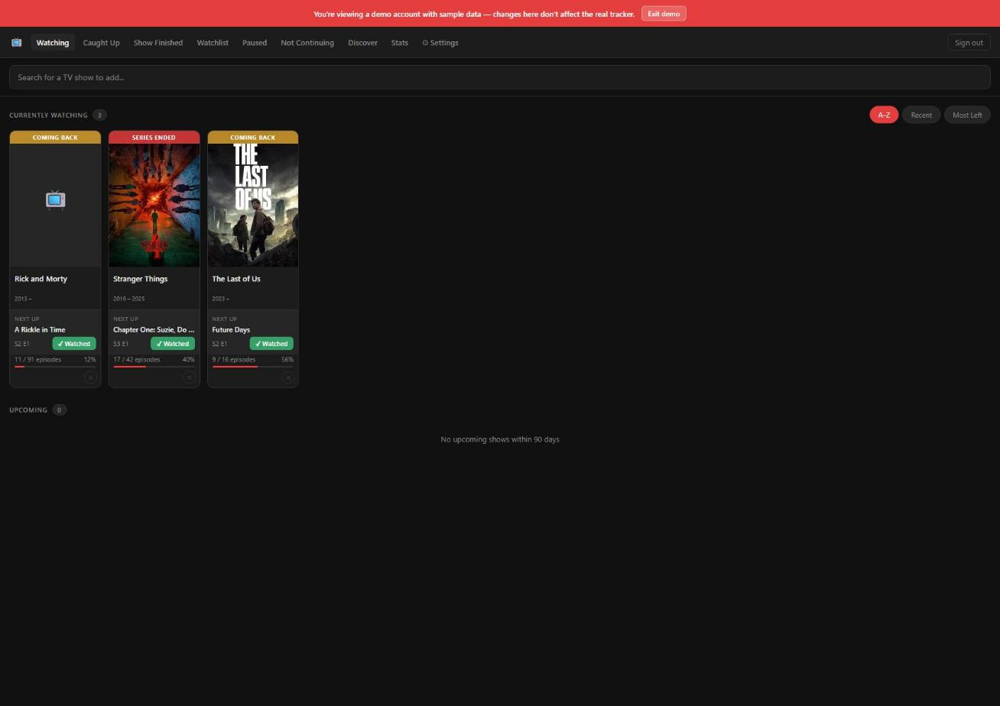

# Showly

A full-stack TV show tracker. Search for shows, build a watchlist, track upcoming episodes, and browse a discovery feed powered by the TMDB API.

[](https://showly-production.up.railway.app)



## Features

- User login with session-based auth
- Show search and detail pages (seasons, episodes, streaming providers) via TMDB
- Trending and genre-based discovery feed with similar-show recommendations
- Personal watchlist with per-season and per-episode tracking
- Upcoming episode tracking and personal viewing stats
- Custom tags and per-user settings

## Tech stack

- **Backend:** Node.js, Express, express-session
- **Database:** PostgreSQL (pg)
- **Frontend:** Vanilla JavaScript, HTML, CSS
- **External API:** The Movie Database (TMDB)
- **Hosting:** Railway

## Running locally

```bash
npm install
# set DATABASE_URL, SESSION_SECRET and TMDB_API_KEY in your environment
npm start
```
